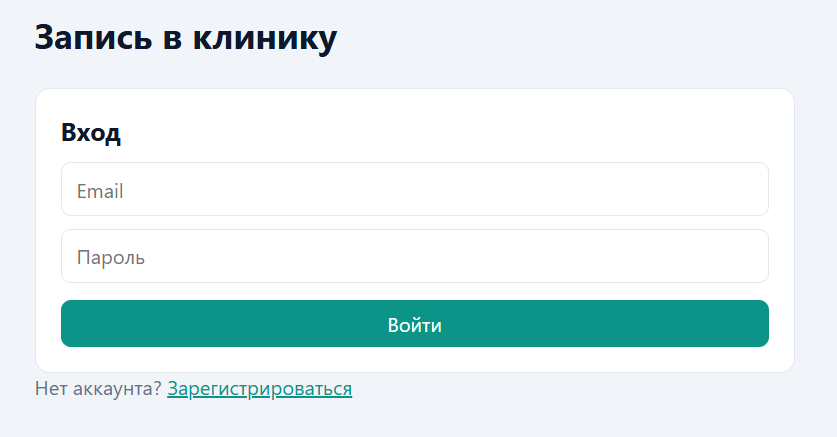
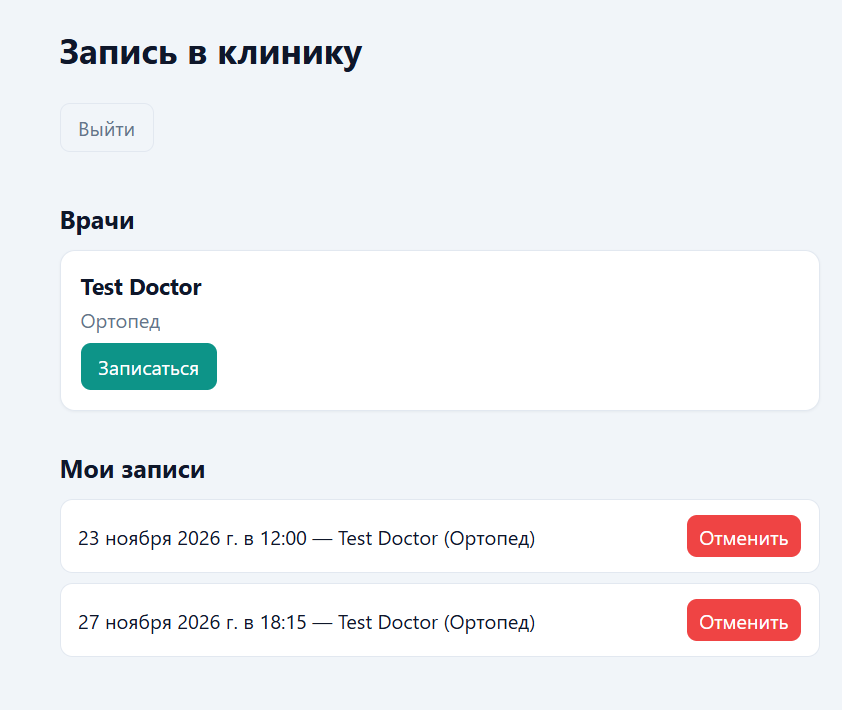

# Clinic Booking

Система записи на приём в клинику. Пациенты регистрируются, выбирают врача и записываются на приём, а сервер не даёт занять одно и то же время дважды.




## Возможности

- Регистрация и вход, авторизация по JWT-токену
- Три роли (пациент, врач, администратор), права проверяются на сервере
- Список врачей
- Запись на приём; двойное бронирование запрещено на уровне базы данных (UNIQUE)
- Список «Мои записи» и отмена записи (пациент может отменить только свою)

## Стек

- **Frontend:** React, TypeScript, Vite
- **Backend:** Node.js, Express, TypeScript
- **База данных:** PostgreSQL
- **Безопасность:** хеширование паролей (bcrypt), JWT, параметризованные SQL-запросы

## Как запустить

Нужны Node.js 20+ и PostgreSQL.

1. Создай базу `clinic_booking` и выполни в ней скрипт `backend/sql/schema.sql`.
2. В папке `backend` создай файл `.env`:

```
DB_HOST=localhost
DB_PORT=5432
DB_USER=postgres
DB_PASSWORD=твой_пароль
DB_NAME=clinic_booking
JWT_SECRET=длинная_случайная_строка
```

3. Запусти бэкенд (порт 3000):

```
cd backend
npm install
npm run dev
```

4. В другом терминале запусти фронтенд (порт 5173, запросы `/api` проксируются на бэкенд):

```
cd frontend
npm install
npm run dev
```

5. Открой http://localhost:5173

Врачей пока нельзя создать через интерфейс. Зарегистрируй пользователя, затем выполни в базе:

```sql
UPDATE users SET role = 'doctor' WHERE email = 'doctor@example.com';
INSERT INTO doctors (user_id, speciality)
SELECT id, 'Ортопед' FROM users WHERE email = 'doctor@example.com';
```

## API

| Метод | Адрес | Доступ | Описание |
|---|---|---|---|
| POST | /api/auth/register | все | Регистрация (роль patient) |
| POST | /api/auth/login | все | Вход, возвращает токен |
| GET | /api/doctors | авторизованные | Список врачей |
| POST | /api/appointments | пациент | Записаться на приём |
| GET | /api/appointments/my | пациент | Мои записи |
| DELETE | /api/appointments/:id | пациент | Отменить свою запись |

## Планы

- Панель врача (просмотр своих приёмов) и панель администратора
- Запуск через Docker
- Автотесты
